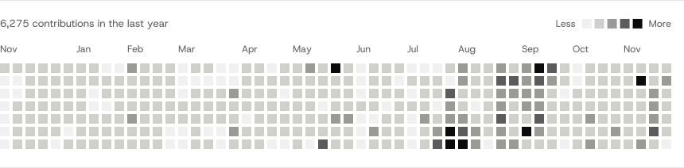

<picture>
  <source media="(prefers-color-scheme: dark)" srcset="assets/header-dark.svg" />
  
</picture>

<a href="https://privent.ai"><picture><source media="(prefers-color-scheme: dark)" srcset="assets/btn-privent-dark.svg" /></picture></a>&nbsp;
<a href="https://linkedin.com/in/devgorkemyagci"><picture><source media="(prefers-color-scheme: dark)" srcset="assets/btn-linkedin-dark.svg" /></picture></a>&nbsp;
<a href="mailto:gorkem@privent.ai"><picture><source media="(prefers-color-scheme: dark)" srcset="assets/btn-email-dark.svg" /></picture></a>

 

<picture>
  <source media="(prefers-color-scheme: dark)" srcset="assets/heatmap-dark.svg" />
  
</picture>
